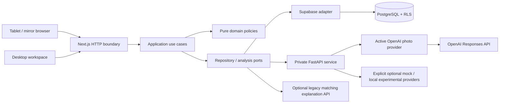

# Architecture and durable decisions

The primary `/kiosk` uses `BeautyCompleteConsultations`: age range → independent purpose consents → fresh capture → one palette/face/base confirmation → skin-first complete report. UI/HTTP call application use cases; framework-free domain policies perform independent skin and cosmetic matching; demo/Supabase/private FastAPI adapters implement ports. One strict `beauty-complete-v1` OpenAI photo request yields separately quality-gated skin/style facts. A new photo-only recommendation context leaves missing preferences unknown and never fabricates a completed questionnaire. Existing skin/color/beauty APIs and QR contracts retain their own admission guards; legacy claims cannot bypass the integrated source guard.

Only usable pores/spots/fine-lines add approved cosmetic goals; redness/flaking do not infer sensitivity/moisture. Ingredient reasons use reviewed policy and registered formulas. Versioned common cosmetic shades have disjoint color/base details, independent of formulation and store listing. Matching requires verified tenant/store, reviewed published metadata, complete formula, stock, visibility and current exclusions. Base depth/undertone require guest confirmation; default concealer purpose is match.

The browser computes gated geometric ratios locally and keeps pixels, ratios, animal vibe and optional adult Gender in memory. English/Korean/Spanish presentation is deterministic and makes no extra AI request. Adult consented completed-session demographics are aggregated exactly once into separate weekly age/Gender counters; individual Gender is never stored. The last four closed UTC weeks suppress any distribution with a nonzero cell below ten. Under13 photo use is prohibited; teen release needs two explicit default-off gates.

Explicit Gender may supply an editorial styling default locally (Man→masculine, Woman→feminine, other/declined→balanced). Only the allowlisted transient direction is forwarded to individual preview requests, never the raw Gender or inferred identity. It changes style prompts/card IDs, not skin/color matching, and is absent from persistence and QR. Local guide presentation may use it as a separate transient argument. Existing clients omit the new private optional field and remain balanced-compatible.

Nine independently claimed original-photo edits run sequentially through `/v1/generate/beauty-preview`, with distinct opt-in,60s provider/75s transport/80s browser bounds,12min plan or15min absolute session first. Each completion appears immediately; failed slots are terminal, no retries. Source/preferences/consent/liveness are checked before and after work. Direction changes, hidden/exit/finish/expiry clear browser references and reject late results. SQL stores only consent/claim/status metadata, never images/prompts/response blobs. Database mutations and writes serialize on the same session row; stable reads remain nonlocking for PostgREST.

New seven-day `beauty-complete-guide-v1` saves confirmed style choices, locale and original eligible formula/shade refs only; legacy guide versions remain readable. Random256bit fragment capability/hash-only DB; anonymous publishable-key read/revoke, no staff/service role/direct table SELECT. Current version/stock changes mark original products unavailable without substitution. Explicit save consent and publicHTTPS gate issuance; local localized HTML/print remains available. See [BEAUTY-KIOSK.md](BEAUTY-KIOSK.md).

## Boundaries

`src/domain` contains ingredient canonicalization, catalog validation, CSV parsing and deterministic recommendation rules. It imports neither React, Next nor Supabase. `src/application` coordinates consent, questionnaires and analysis through ports. `src/interfaces/http` validates bounded requests and verified identity; it never accepts tenant identity from a product or session body. `src/infrastructure` implements the demo, Supabase and HTTP-analysis adapters. `src/ui` renders workflows and holds temporary camera memory. `services/analysis` is an independent Python service with its own domain/application/provider boundary.

Flat Product DTOs are read models, not database tables. PostgreSQL normalizes brands/products/variants, immutable formulation versions, canonical ingredient joins, draft unresolved names, store listings, versioned policies/rules, consent/answers/observations/recommendation reasons and staff/device authorization. See DATABASE.md for keys, tables, grants, constraints and setup. Composite tenant foreign keys defend against relationships crossing organizations in addition to RLS.

Catalog field limits live in the domain and are reused by HTTP schemas and the editor. The application prepares new catalog writes using an injected server SKU generator; stored SKUs remain nonempty and existing identities are immutable. Ingredient text parsing is a bounded pure domain function. Raw pasted reports stay in the browser until names are explicitly reviewed; the API receives only names. Catalog validation returns authored messages keyed by known fields, with no schema internals or raw input in errors.

`src/domain/skin-consultation.ts` builds the pure, versioned `SkinConsultationReport` from strict saved OpenAI observations and approved matching facts. It writes professional cosmetic interpretations, identifies selected/photo/both goal sources, shortlists canonical ingredients with exclusions applied, and explains only existing eligible product reasons. Seven bounded ingredient-purpose entries carry reviewed cosmetic-function sources; other ingredients receive policy-only rationale without invented benefits. `src/application/skin-consultation.ts` assembles this derived read model through repository ports and checks that the session remains active before returning it. The report is a read DTO, not a new database entity, analysis provider or ranking engine; it never reads image bytes or calls an LLM. The real photo observation remains the single direct OpenAI vision request.

## Trust and identity

Staff Auth and anonymous paired-device Auth have separate HTTP-only cookie namespaces. The server verifies users using Auth getUser and derives organization/store roles through database RPCs. A code is hashed, single-use and short-lived. Devices receive no staff permissions. Sensitive context is requested through route handlers so refreshed cookies can be persisted. Do not add authenticated server-rendered pages without adding the equivalent cookie-refresh proxy.

The BFF uses the caller's restricted Supabase identity for reads and catalog/device RPCs. Analysis/recommendation writes use an independently provisioned restricted PostgreSQL login inheriting `analysis_writer`, never a service-role browser key. The pool verifies role privileges and remote database TLS certificates. Production missing configuration fails closed. `APP_MODE=demo` is an intentional explicit production option for previews only; never expose it as a live tenant workspace.

## Runtime flows

1. The paired device starts/resumes one active consultation. Active OpenAI mode records main notice `2026-10-openai-v1` and separate initially unticked adult/single-subject external-photo notice `2026-10-openai-photo-v1`. A declined photo choice skips camera/image access and continues with questionnaire/store policy.
2. The BFF validates typed answers and verified device/session scope. With photo consent, local MediaPipe positioning starts a cancellable three-second capture countdown. Browser tracks/object URLs are stopped/revoked on leave, pause, reset and finish. Presence guidance does not prove photo or skin quality.
3. An atomic durable session claim admits at most one external photo attempt before the BFF calls private `/v1/analyze/openai`. The Python provider decodes bounded static input, applies orientation, resizes and reconstructs clean RGB JPEG pixels without EXIF/ICC/XMP/text. Only the sanitized photo reaches the fixed OpenAI Responses endpoint with pinned `gpt-4.1-mini-2025-04-14`, strict five-feature enums, `store:false`, no tools/history/retries and at most 30 seconds. No tenant, questionnaire, product/ingredient, source-training record or identity accompanies it. No-photo calls skip OpenAI and return `vision:null`. The BFF validates pinned mode/model/prompt, request identity, exact feature domains and quality consistency.
4. Pure `skin-vision` policy can add only usable/visible pores→texture, spots→uneven tone and fine lines→fine lines to the selected goals. Redness/flaking do not infer hydration/sensitivity; uncertain/limited/unassessable input adds no goal. The pure recommendation engine uses that bounded goal union and reviewed tenant policy, with complete published formula, same-store stock/visibility and exclusions still authoritative. SQL independently verifies any photo-derived reason against saved usable feature rows. OpenAI does not choose products or bypass policy.
5. The restricted writer persists normalized metadata, feature enums/quality flags and recommendation reasons, never pixels or raw API responses. Completed results reload without another call. The application derives `skin-consultation-v1` from the saved observations, selected goals, applicable ingredient policy and eligible store-registered product reasons; current catalog changes may remove previous matches, never fabricate replacements. The kiosk shows a professional summary and source-labelled care priorities, expandable five-feature detail, ingredient rationales and actual product matches in that order. Empty catalogs retain the summary and ingredient guide. Example onboarding policies remain identified as examples. This interpretation creates no extra external request, transfer or prose persistence. Failure/unknown claims cannot retry externally; the UI offers photo-free completion or finish/new session. A photo-free completion can supersede in-flight work; finished sessions and already-persisted analysis are rechecked before late writes. Product-only LLM explanations are disabled in this mode.
6. Finish/decline/revoke/expiry removes session-linked answers, observations, photo consent/attempt metadata and recommendation children. Only allowed minimal consent/closed-session metadata and aggregate store/day counters remain under existing retention. Staff cannot read individual results. Application memory-only handling does not remove provider retention; `store:false` is not zero retention. See [OPENAI-SKIN-SETUP.md](OPENAI-SKIN-SETUP.md).

Preserved optional modes remain separate contracts: mock sends an opaque request ID/questionnaire without pixels; experimental warm-loads saved ConvNeXt and ingredient models and accepts only supported whole source-code categories witnessed in retained TRAIN profiles. No guessed image/profile join or clinical code mapping is added. Optional hosted post-ranking ingredient explanations remain available in those modes under their original separate consent and durable claim. They never determine ranking. See [KIOSK-MODEL-SETUP.md](KIOSK-MODEL-SETUP.md) and [LLM-SETUP.md](LLM-SETUP.md).

Only the optional experimental provider requires the private immutable `contracts/{ingredient-manifest}-source-codes-v1.json` support artifact. It supports 145 witnessed whole categories from 4,824 retained TRAIN profiles without retraining or changing checkpoints. Existing normalized coverage flags retain actual code use/omission; private witnesses never enter HTTP/SQL. The prior source-code integration itself needs no migration. Active OpenAI mode does not load weights, Torch or this artifact; its normalized consent/attempt/appearance persistence uses migrations `202610110004`/`202610110005`. See [ML-SOURCE-CODE-CONTRACT.md](ML-SOURCE-CODE-CONTRACT.md) and [DATABASE.md](DATABASE.md).

## Scaling decisions

The independent ConvNeXt/OpenAI comparison remains a research CLI outside serving, with dedicated consent/hash/source/retention gates and private outputs. Its strict HTTP appearance protocol is reused by the explicitly configured OpenAI serving adapter without importing Torch or training. Research results never automatically promote a provider or enter the app database. The user later explicitly requested OpenAI serving; that change is not a comparison winner or validated accuracy finding. See [VISION-COMPARISON.md](VISION-COMPARISON.md).

This is a modular monolith BFF plus one analysis service. It avoids premature microservices while keeping inference deployable independently. Supabase mode is the horizontal scaling path: durable shared state lives in PostgreSQL, with database transactions and uniqueness constraints. Demo mode intentionally uses one Node process and local catalog JSON, and is not a scalable production adapter.

The in-process request limiter is a defensive MVP boundary, not a distributed quota. Before multiple BFF replicas or public production traffic, enforce shared per-identity/IP quotas and configure trusted forwarding headers. OpenAI mode needs shared external-call budgets, provider outage monitoring and independent appearance/quality evaluation; optional local GPU inference additionally needs a worker/capacity plan. Bounded in-memory input, one-attempt claims, timeout, normalized persistence and cleanup do not provide clinical validation or distributed request quotas.

## Stable decisions

- Next.js App Router + TypeScript for kiosk/workspace/BFF; FastAPI for future Python inference; Supabase Auth/PostgreSQL for tenancy.
- Ingredient-first reviewed policy remains the eligibility authority. Active OpenAI mode adds bounded usable visible-feature goals, then uses deterministic policy ranking without learned ingredient candidates. Optional experimental mode preserves candidate-weighted ranking and witnessed photo-code categories. Neither mode overrides skin type, sensitivity, exclusions or store eligibility. Optional hosted product explanations are disabled in OpenAI mode and never decide ranking in other modes. LambdaRank requires reliable interaction labels before a future replacement behind a port.
- On 2026-10-11 the user explicitly selected direct OpenAI skin-photo observation instead of ConvNeXt, after the independent-comparison workflow had been prepared without real evaluation photos. There is no measured accuracy winner. Earlier approved ConvNeXt/ingredient experiments and data permissions remain preserved; source-code clinical meanings, person grouping, image/profile linkage and combined accuracy remain unresolved. See [OPENAI-SKIN-SETUP.md](OPENAI-SKIN-SETUP.md) for the active provider and the ML guides for optional research.
- No customer profiles or raw photo persistence in the MVP. Anonymous device identity is operational, not biometric identity.
- Immutable published formulas/policies keep results auditable during their short lifetime. New product data updates the catalog, not model weights.

## Operational omissions tracked explicitly

The repository does not provision production accounts, buy hosting, deploy endpoints, configure custom domains, connect POS, provide native kiosk lockdown, calibrate camera hardware, run migrations against a live cloud project or demonstrate clinical validity. Those are explicit pilot/deployment tasks, not implied by the mock UI.
