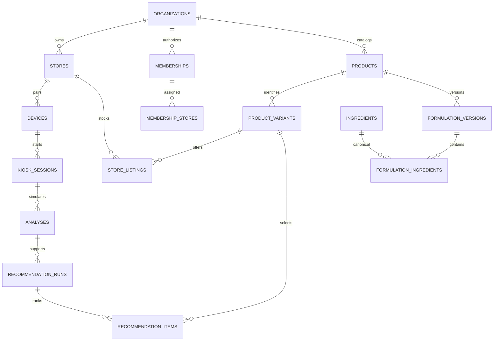

# Database foundation

Current integrated additions are described in the integrated section below and [BEAUTY-KIOSK.md](BEAUTY-KIOSK.md). Earlier sections document preserved legacy migrations and their historical verification counts. The current restricted writer has exactly nine signatures; prior six/seven-function counts are historical.

Migration `202610110012_beauty_features_makeup.sql` adds normalized eye/nose/lip appearance categories to transient beauty analysis and supports exact v1/v2 writer/read branches. Separate `session_beauty_makeup_consents` and `session_beauty_makeup_attempts` record purpose and an immutable one-attempt/preference pin only; no images, prompts or output table. Paired-session RPCs set/read purpose, atomically claim and reassert after generation. Late work fails after withdrawal, confirmation changes, finish, expiry or device revocation; lifecycle purge covers both new relations. At that migration, restricted writer signatures remained exactly seven; no new direct table privilege.

## Primary beauty and saved guides

Migrations `202610110010_beauty_saved_guides.sql` and `202610110011_beauty_metrics_guide_version.sql` add independently normalized beauty purpose consent, durable attempt, strict categorical observation/quality flags and confirmed style preferences. Main consent is required; skin answers are not. Each relationship uses tenant-safe composite FKs and RLS/owned-device RPCs. The seventh restricted writer decomposes the exact nine-key pinned beauty protocol; no pixels/provider prose/blob is retained. Withdrawal permanently invalidates a pending attempt; finish/revoke/expiry purge transient beauty records.

Separate seven-day guide consent creates a version-pinned confirmed-preference snapshot and up to three original eligible variant/formula/shade-version references. Only a random capability hash is stored. Saved data has its own retention and survives kiosk Finish; no identity/photo/AI observation/skin questionnaire is copied. Public anonymous/authenticated RPCs accept the hash for read/revoke, without direct table SELECT or service-role access. Current catalog changes can mark original products unavailable without replacing them. The minute cleanup expires guides; unknown guide versions fail closed in the BFF. A private once-per-session marker counts skin/beauty analysis only once; a confirmed manual beauty guide counts as completed on Finish, while abandoned/revoked/expired sessions do not. All17 migrations, exact7 writer signatures and490 PostgreSQL pgTAP assertions pass locally. See [BEAUTY-KIOSK.md](BEAUTY-KIOSK.md).

Read this file for database changes. Read the current task in `STATUS.md` first; the migrations are the executable source of truth. Consultations explicitly distinguish active OpenAI visible-photo observation, optional local experimental inference and mock simulation.

## Active OpenAI photo observations

The separate optional [personal-color feature](PERSONAL-COLOR.md) adds migrations `202610110008_personal_color.sql` and `202610110009_lip_shade_visibility.sql`. Merchant shade versions/current pointers reuse existing variants/formulations/listings; separate normalized transient rows hold color purpose consent, a one-attempt claim, categorical observation, quality flags and guest-confirmed preferences. Guest shade reads expose only current eligible listed versions; authorized staff retain metadata history. Staff cannot read individual color results. Finish/revoke/expiry purge color rows, withdrawal invalidates pending attempts permanently, and the exact sixth writer RPC accepts a separately generated opaque request UUID. No photo, arbitrary provider blob, generated prose or recommendation array is stored. Local PostgreSQL pgTAP now passes373checks/7files with92color-specific assertions and exact-six-writer validation; hosted staging remains unverified.

Migrations `202610110004_openai_skin_analysis.sql` and `202610110005_openai_skin_routing.sql` add a separately consented provider contract without saving images or opaque response blobs. `session_vision_consents` records the versioned adult/single-subject external-photo choice; `session_vision_attempts` owns one durable external-attempt claim per session, including an invalidation marker on withdrawal. Main consent is `2026-10-openai-v1`; photo notice is `2026-10-openai-photo-v1`. A declined photo choice does not prevent questionnaire-only results.

`analyses` holds pinned model, mode `openai`, quality `usable|limited|not_assessable|not_provided` and fixed application disclaimer. `analysis_vision_outputs` holds the pinned prompt version; `analysis_vision_features` holds exactly five bounded feature/value pairs; `analysis_vision_quality_flags` holds unique allowlisted image limitations. These are fixed typed categories, not an arbitrary questionnaire/EAV store. `not_provided` has no vision child rows. No pixels, raw provider response, arbitrary generated text, photo filename or source-training record enters these relations. Tenant-safe composite FKs, RLS and the existing cleanup cascade apply. Staff cannot read individual results.

Paired devices record photo consent and atomically claim at most one photo attempt before external processing. The restricted `write_openai_analysis` RPC independently checks active paired device/store/session, current consent, completed answers, claim state, exact pinned contract, field domains and quality consistency. It decomposes transport JSON transactionally. Photo-free completion can supersede an outstanding request, but completed results are immutable and late writes cannot replace them. Claims survive failed/unknown attempts until session cleanup; no restart or concurrent request creates a second external attempt. Clearing local state cannot recall an already transmitted provider request.

Recommendation reasons must match either a selected concern or an allowed saved usable/visible feature: pores→texture, spots→uneven tone, fine lines→fine lines. SQL independently verifies that relation alongside published tenant policy, actual formula membership, exclusions, stock and visibility. Redness/flaking and limited/unassessable photos authorize no extra goal. The new mode has no learned ingredient candidates or ConvNeXt codes. Its photo observations remain visible even when no product qualifies. The optional product-text explanation subsystem is disabled for this provider. See [OPENAI-SKIN-SETUP.md](OPENAI-SKIN-SETUP.md).

Migrations `202610110006_skin_consultation_policy.sql` and `202610110007_skin_consultation_policy_readonly.sql` expose the original recommendation policy through the paired guest's `read_kiosk_recommendation_policy(p_session_id)` read RPC. It asserts an active owned session and returns the policy version already referenced by `recommendation_runs.policy_version_id`; a later publication cannot rewrite completed guidance. With no run yet, it reads the currently published policy. The `STABLE` RPC uses the existing nonlocking own-session guard, since PostgREST executes stable reads in read-only transactions. It grants no writer or staff access to personal results. Policy source distinguishes operator configuration from an onboarding example.

The professional consultation report is derived in application/domain memory from these typed observations, the pinned policy and eligible registered products. No additional generated prose, image, free-text blob or table is persisted. Reload rechecks current catalog eligibility and the final live session; it can remove previously recommended products, never introduce or reorder matches. Independent ingredient guidance remains available when the store has no eligible product. See [ingredient editorial sources](INGREDIENT-GUIDANCE.md).

## Optional hosted explanations

This preserved post-ranking subsystem applies to mock/experimental modes. It is not the active OpenAI photo-analysis or photo-consent contract.

Migration `202610110003_api_explanations.sql` adds three normalized transient relations: `session_explanation_consents` records the separate versioned choice, `recommendation_explanation_runs` owns the durable pending/generated/fallback claim and summary/provenance, and `recommendation_product_explanations` references exact ranked recommendation items. Composite organization/session/run/item foreign keys enforce tenant and result ownership. No API request or response JSON is stored.

Paired devices may call `record_explanation_consent` before analysis and `claim_kiosk_explanation` after finalized results. The atomic unique claim prevents multiple external attempts across requests/restarts. The fourth restricted-writer signature, `complete_recommendation_explanation(uuid,text,text,jsonb,text,text)`, rechecks active session/device/current consent and exact product count/order, then decomposes bounded locally rendered text. No new direct writer table privileges exist. RLS excludes staff from individual explanations. Read DTOs include only completed notes; purge cascades through the analysis/recommendation hierarchy and explicitly deletes optional consent on finish, revoke and expiry. See [LLM setup and privacy](LLM-SETUP.md).

## Model and normalization

The schema uses normalized relations rather than storing catalog, questionnaire, ingredient matches or recommendations as JSON. JSON RPC arguments are transport DTOs, validated and decomposed inside one transaction. The only durable aggregates are store/day counters with no customer identifiers.

| Area                      | Relations and ownership                                                                                                                                                                                                                             |
| ------------------------- | --------------------------------------------------------------------------------------------------------------------------------------------------------------------------------------------------------------------------------------------------- |
| Tenancy                   | `organizations`, `stores`, `memberships`, `membership_stores`; owner organization scope, manager/viewer explicit store assignments                                                                                                                  |
| Devices                   | `devices`, `device_pairing_codes`; anonymous Auth identity belongs to a device, never a customer                                                                                                                                                    |
| Catalog                   | `brands`, `categories`, `products`, `product_variants`; shared per organization, SKU unique within organization                                                                                                                                     |
| Formulations              | `formulation_versions`, `formulation_ingredients`, `unresolved_formulation_ingredients`, `formulation_skin_types`, `variant_formulations`; ordered canonical and unresolved draft ingredient names, suitability joins, immutable published versions |
| Store availability        | `store_listings`; store-specific price in integer minor units, ISO currency, stock and visibility                                                                                                                                                   |
| References                | Global `ingredients`, `ingredient_aliases`, `concerns`, `skin_types`, `questionnaire_versions`; client reads only, curated by deployment administrator                                                                                              |
| Recommendation rules      | `recommendation_policy_versions`, `concern_ingredient_rules`; tenant-owned immutable published rule version                                                                                                                                         |
| Transient consultation    | `kiosk_sessions`, `consents`, `session_concerns`, `session_excluded_ingredients`, `analyses`, `observations`                                                                                                                                        |
| Experimental outputs      | `analysis_model_outputs`, `analysis_visual_heads`, `analysis_visual_probabilities`, `analysis_ingredient_candidates`, `analysis_input_coverage`; model versions, opaque categorical codes, relative scores and available feature names only         |
| OpenAI photo metadata     | `session_vision_consents`, `session_vision_attempts`, `analysis_vision_outputs`, `analysis_vision_features`, `analysis_vision_quality_flags`; fixed consent/attempt/prompt/features/quality only, no image or arbitrary provider text               |
| Recommendation provenance | `recommendation_runs`, `recommendation_items`, `recommendation_item_ingredients`, `recommendation_item_reasons`; actual policy, ranked variants and validated matching reasons                                                                      |
| Operations                | `audit_events` contains actor/action/resource metadata only; `store_daily_metrics` contains starts/completions/analyses per UTC day                                                                                                                 |

Every tenant child carries `org_id` and references its parent using a composite tenant foreign key. Cross-organization IDs therefore fail even if an application authorization bug occurs. The `variant_formulations` relation also binds variant and formulation to the same product. Global reference tables intentionally have no tenant key.

The questionnaire is deliberately represented as fixed, typed answers: one skin type and self-reported sensitivity, multiple concerns, multiple excluded ingredients. It is not an arbitrary survey builder or EAV answer store. `questionnaire_versions` identifies the deployed question semantics; changing them requires a versioned application/database migration.

Experimental outputs are decomposed into separate relations, rather than a saved response blob. `(org_id, analysis_id, kind)` identifies each visual/ingredient model output. Each visual head has separate per-code relative outputs; these never become clinical observations or severity levels. Ingredient candidate names remain checkpoint labels and are not automatically added to the reviewed catalog INCI dictionary. Candidate scores, including supported photo-code contributions, influence application ranking only after intersection with approved policy rules and complete published product formulas. A missing candidate cannot supply a product match. Input coverage stores bounded feature/provenance names, not raw questionnaire text, source records or inferred demographics. Every output relation has a tenant-safe composite FK and cascades when the transient parent analysis is purged.

The source-code integration reuses these relations and needs no migration. `analyses.model_version` adds `:source-codes-v1`; the separate visual/ingredient model versions still identify unchanged checkpoints. `analysis_input_coverage` preserves `source_code_contract_aihub71886_v1` and either `visual_condition_used_source_contract_v1` or `visual_condition_unseen_in_training_omitted`, where applicable. This distinguishes actual use from omitted combinations across session reloads. The private `contracts/{ingredient-manifest}-source-codes-v1.json` support artifact and TRAIN-profile witnesses never enter the database or HTTP responses. The ingredient adapter checks exact whole-category training support before scoring; SQL continues validating selected concerns, published tenant policy, product ingredients, stock and exclusions without assigning clinical meaning to source codes. See [ML-SOURCE-CODE-CONTRACT.md](ML-SOURCE-CODE-CONTRACT.md).



## Authorization boundaries

- RLS is enabled on every public table. `anon` has no application table access. `authenticated` has scoped reads and **no direct table mutations**, including staff owners.
- Staff role comes from active `memberships` and a non-anonymous verified Auth JWT. A confirmed new owner can create only a new workspace through the guarded bootstrap RPC; it cannot select an existing tenant or grant itself existing-tenant membership. Auth metadata never grants authority.
- An anonymous JWT needs an active paired device and active store. It can start/read/finish only its own active session, record explicit consent and save typed answers. A unique partial index permits only one active session per device; row locks make starts idempotent.
- Owners manage the shared catalog and all stores. Assigned managers manage their store listings and devices. Assigned viewers read aggregate store reports. Staff cannot browse individual customer answers/results through RLS or RPCs.
- All `SECURITY DEFINER` functions pin `search_path`, qualify relations and assert caller scope. `private` helpers are outside the exposed API schemas. Function execution is explicitly revoked from `PUBLIC` and selectively granted.
- The `analysis_writer` role has only six reviewed RPC signatures: `write_analysis_result`, `write_experimental_analysis`, `write_openai_analysis`, `persist_recommendations`, `complete_recommendation_explanation` and `write_openai_color_analysis`. It has no catalog/session/output SELECT permission or arbitrary table writes. The BFF verifies paired device/session/current consent before using that server-only connection. Staff cannot read individual output tables; the paired device reads only its own live session.
- No storage buckets or raw image columns exist. The local Storage service is disabled. Never add image/request-body content to audits.

Paired-device credentials must remain separate from staff login credentials. A revoked device loses access immediately. Re-pair with a fresh anonymous Auth identity; membership grants never come from an Auth signup trigger.

## RPC contracts

`org_id` is internal SQL naming; read DTOs use `organization_id`. All UUIDs below are server-generated except existing target resource IDs. All client calls use the verified caller JWT.

| OpenAI extension RPC                                                                                      | Contract                                                                                                                                                                                                                                                                                |
| --------------------------------------------------------------------------------------------------------- | --------------------------------------------------------------------------------------------------------------------------------------------------------------------------------------------------------------------------------------------------------------------------------------- |
| `record_vision_consent(p_session_id,p_notice_version,p_accepted)`                                         | Paired own device; explicit `2026-10-openai-photo-v1` choice after current main consent. Pending choice can be withdrawn, which invalidates an existing attempt without removing its one-attempt guard.                                                                                 |
| `claim_kiosk_vision_analysis(p_session_id)`                                                               | Paired own device; completed answers/current accepted main+photo consent required. Unique per-session claim returns true at most once before an analysis exists.                                                                                                                        |
| `write_openai_analysis(p_session_id,p_request_id,p_model_version,p_quality_status,p_disclaimer,p_vision)` | Restricted writer only; pinned model/prompt/disclaimer and bounded five-feature/quality protocol. Photo-free `vision:null` requires no new external call and can complete a failed/pending attempt's session. One immutable analysis per request; repeats return the existing analysis. |

| Function                                                                                                     | Inputs / return                                                                                                                                                                                                                                                                                                                                                                                                                                                                                                                                                                                                                                                       |
| ------------------------------------------------------------------------------------------------------------ | --------------------------------------------------------------------------------------------------------------------------------------------------------------------------------------------------------------------------------------------------------------------------------------------------------------------------------------------------------------------------------------------------------------------------------------------------------------------------------------------------------------------------------------------------------------------------------------------------------------------------------------------------------------------- |
| `staff_context()`                                                                                            | `{organization_id, organization_name, role, stores:[{id,name,location,currency}]}`; v1 selects the first active organization by ID if an operator belongs to several                                                                                                                                                                                                                                                                                                                                                                                                                                                                                                  |
| `owner_setup_eligible()`                                                                                     | Read-only boolean for a confirmed permanent email/password identity with no device association or membership of any status. Prevents revoked/existing staff from entering first-owner setup; exposes no tenant/Auth record details.                                                                                                                                                                                                                                                                                                                                                                                                                                   |
| `create_owner_workspace(p_organization_name,p_store_name)`                                                   | Confirmed permanent email identity with no prior membership; creates a new organization, first USD store, owner membership and published mock policy atomically; returns `staff_context` JSON. Repeated calls with identical names reuse the same existing owner workspace; no tenant/resource IDs accepted.                                                                                                                                                                                                                                                                                                                                                          |
| `device_context()`                                                                                           | `{organization_id,store_id,device_id}`                                                                                                                                                                                                                                                                                                                                                                                                                                                                                                                                                                                                                                |
| `create_pairing_code(p_store_id,p_label)`                                                                    | Owner/assigned manager; returns `{pairing_code,expires_at}`; random 16-character hexadecimal code, SHA-256 hash stored, one use, 10-minute expiry                                                                                                                                                                                                                                                                                                                                                                                                                                                                                                                     |
| `pair_device(p_code)`                                                                                        | Unenrolled anonymous identity; returns device context                                                                                                                                                                                                                                                                                                                                                                                                                                                                                                                                                                                                                 |
| `read_store_devices(p_store_id)` / `revoke_device(p_device_id)`                                              | Owner/assigned manager; read omits Auth user ID; revoke purges active session details                                                                                                                                                                                                                                                                                                                                                                                                                                                                                                                                                                                 |
| `read_store_metrics(p_store_id)`                                                                             | Owner/assigned manager/viewer; last 30 UTC days, `{day,sessions_started,sessions_completed,sessions_analyzed}`                                                                                                                                                                                                                                                                                                                                                                                                                                                                                                                                                        |
| `start_kiosk_session()`                                                                                      | Paired device; returns active session UUID, reuses existing non-expired session                                                                                                                                                                                                                                                                                                                                                                                                                                                                                                                                                                                       |
| `record_consent(p_session_id,p_policy_version,p_accepted)`                                                   | Explicit `2026-10-mvp`, `2026-10-experimental-v1` or `2026-10-openai-v1` notice; immutable choice and version; decline immediately closes session                                                                                                                                                                                                                                                                                                                                                                                                                                                                                                                     |
| `save_answers(p_session_id,p_skin_type,p_concerns,p_excluded_ingredients,p_sensitive)`                       | Skin/concern slugs, canonical INCI exclusions, sensitivity boolean; consent required; answers lock after analysis                                                                                                                                                                                                                                                                                                                                                                                                                                                                                                                                                     |
| `read_kiosk_session(p_session_id)`                                                                           | Own active session with answers, explicit mock/experimental/openai analysis and recommendation references. Experimental results reconstruct normalized outputs and model metadata; no image data. `recommendations:null` means not run, `[]` means run with zero eligible products                                                                                                                                                                                                                                                                                                                                                                                    |
| `finish_kiosk_session(p_session_id)`                                                                         | Own device; idempotently clears sensitive answers, observations and recommendation details; counts a completion only if an analysis existed before cleanup                                                                                                                                                                                                                                                                                                                                                                                                                                                                                                            |
| `read_store_catalog(p_store_id)`                                                                             | Owner/assigned manager or device for own store; flattened product variant read model, ordered canonical ingredients and skin slugs. Device receives only active, visible, in-stock, complete published variants                                                                                                                                                                                                                                                                                                                                                                                                                                                       |
| `save_catalog_draft(p_store_id,p_product)`                                                                   | Owner only; returns variant UUID; SKU identifies an existing variant; unrecognized INCI is preserved in a normalized draft-only review relation                                                                                                                                                                                                                                                                                                                                                                                                                                                                                                                       |
| `import_catalog_drafts(p_store_id,p_products)`                                                               | Owner only; returns UUID array; 1–500 rows, unique SKUs in batch; one invalid row rolls back the entire import                                                                                                                                                                                                                                                                                                                                                                                                                                                                                                                                                        |
| `publish_catalog_variant(p_variant_id)`                                                                      | Owner only; complete reviewed nonempty INCI list required; immutable published formulation version                                                                                                                                                                                                                                                                                                                                                                                                                                                                                                                                                                    |
| `update_store_listing(p_store_id,p_variant_id,p_price_minor,p_stock,p_visible)`                              | Owner/assigned manager; requires published complete formulation before enabling visibility                                                                                                                                                                                                                                                                                                                                                                                                                                                                                                                                                                            |
| `read_recommendation_policy()`                                                                               | Infers tenant from device/staff; latest published `{id,version,rules:[{concern,ingredient,relevance}]}`                                                                                                                                                                                                                                                                                                                                                                                                                                                                                                                                                               |
| `write_analysis_result(p_session_id,p_request_id,p_mode,p_model_version,p_quality_status,p_observations)`    | **Writer only**; returns analysis UUID; this release accepts `mode:mock`, `quality_status:demo`, observations `{concern_id:slug,level:low\|moderate\|high,score:0..1}`; request UUID idempotency                                                                                                                                                                                                                                                                                                                                                                                                                                                                      |
| `write_experimental_analysis(p_session_id,p_request_id,p_model_version,p_disclaimer,p_visual,p_ingredients)` | **Writer only**; requires current experimental consent, completed preferences, active paired device/store and request ID equal to session ID. Saves `mode:experimental`, `quality_status:experimental` and zero observations. Visual input is null or all eight heads with bounded distributions; ingredient candidates and feature-name coverage are bounded and decomposed transactionally. Idempotent per request.                                                                                                                                                                                                                                                 |
| `persist_recommendations(p_session_id,p_analysis_id,p_policy_version_id,p_items)`                            | **Writer only**; returns run UUID, idempotent per mock/experimental/openai analysis; maximum three eligible same-store variants. Each reason must match selected concern or allowed saved usable/visible appearance goal, published policy and actual formulation; exclusions enforced again. Experimental reasons also require a positive saved model candidate for that reviewed canonical INCI, resolved by exact normalized name or an existing unambiguous alias. Broad ingredient families and unknown labels remain unresolved. Application calculates candidate-weighted ordering; SQL validates the match and persists the restricted writer's ranked items. |

Catalog write JSON uses `{sku,brand,name,category,price_minor,stock,ingredients:string[],skin_types:string[],formulation_complete:boolean}`. Currency comes from the verified store, and a newly created listing starts hidden. Publication never overrides any store's visibility choice: explicitly enable the store listing after publishing. Existing product name/brand/category cannot silently change through this RPC; use a distinct SKU until a reviewed metadata-edit workflow exists. Formulation changes create a new draft version while devices continue reading the current published version. Unknown ingredient names can be saved for review, but block publication. The catalog read DTO includes `unresolved_ingredients[]`, merges unresolved names into the original ordered ingredient list, and reports `formulation_complete:false` until all names resolve. Both the publish RPC and a database trigger enforce the boundary.

Recommendation write JSON is `[{variant_id,score,matched_ingredients:string[],reasons:[{concern,ingredient,relevance}]}]`. DTO arrays are not JSON persistence. Matching is ingredient presence with curated relevance, not proof of ingredient concentration, efficacy or allergy safety. The production application injects the actual policy returned by the database, rather than substituting unversioned demo rules.

## Local setup and initial owner

Install a supported Docker-compatible runtime and the Supabase CLI, then run from the repository root:

```text
supabase start
supabase db reset
supabase test db
```

`db reset` destroys the **local** database. Never point this command at production. The config is already initialized; do not run `init` over it. If the CLI is installed as a project dependency, use the project's package runner before each command. Official references: [local development](https://supabase.com/docs/guides/local-development), [database tests](https://supabase.com/docs/guides/database/testing).

The reference-data migration installs 40 canonical INCI names/aliases, concern/skin-type slugs and the fixed questionnaire version in every environment. The local seed adds six fictional formulas, a synthetic organization/store and 19 manually curated demo relevance rules. It seeds no Auth identities, passwords, memberships, devices or customer records. Demo IDs match the domain demo catalog. Apply migrations without the demo seed to a hosted production database; provision that tenant and its independently reviewed policy deliberately.

In local Studio or the hosted project's authenticated administration dashboard, create/invite the initial staff Auth user and confirm their identity. Copy that user's real UUID. Then run the following **as the database administrator** with the real user UUID and target organization UUID:

```sql
-- Example target is the LOCAL synthetic organization. Replace both IDs for production.
insert into public.memberships(org_id,user_id,role)
values ('11111111-1111-4111-8111-111111111111', '<confirmed-staff-auth-user-uuid>', 'owner');
```

Do not create staff by inserting directly into `auth.users`, store passwords in seed files, or grant browser membership mutations. Business owner onboarding is separate from invitations: `/management/signup` creates an email account, email-code verification confirms it, and `/management/setup` explicitly calls `create_owner_workspace`. The RPC requires a real confirmed permanent email user in `auth.users`, rechecks signed anonymous status, serializes concurrent calls by user and creates only a new isolated organization/store. The server generates all IDs. Existing inactive/manager/viewer memberships cannot be upgraded by onboarding; repeated owner setup with identical names returns existing scope instead of creating another tenant. Migration `202610100006` adds `owner_setup_eligible()` so a verified account read distinguishes an unassigned new owner from revoked/existing staff before showing setup. The write RPC independently rechecks every condition. It copies only the fixed 19-rule mock policy, never another retailer's catalog or data.

Later staff invitations and role changes require a separate audited owner administration feature. Keep the email provider, global signup, email confirmation and anonymous device sign-in enabled. Migration `202610100005` replaces the earlier restrictive hook with an invoker-only, table-free `public.senmiva_before_user_created(jsonb)` hook that allows email owner-account signup and real anonymous devices without trusting user metadata. Only `supabase_auth_admin` can execute it. The hook creates no memberships. Local config enables it, disables manual identity linking, requires 12-character passwords and uses a code-bearing confirmation template plus loopback-only Mailpit. Hosted projects must explicitly enable the same Before User Created SQL hook in Authentication and configure SMTP, Confirm email and the `{{ .Token }}` confirmation template; SQL migration alone does not configure hosted Auth. Administrator Auth user creation remains available. Anonymous identities assume the `authenticated` SQL role, so policies also check the signed `is_anonymous` claim and database membership/device records. [Supabase anonymous Auth](https://supabase.com/docs/guides/auth/auth-anonymous), [Before User Created hook](https://supabase.com/docs/guides/auth/auth-hooks/before-user-created-hook)

## Restricted writer connection

Migrations create `analysis_writer` as a non-login, non-superuser, non-bypass-RLS capability role. Create a separate login using the database administrator; provide the password using an interactive password command or deployment secret tooling, never a committed SQL literal:

```sql
create role senmiva_analysis_login login inherit nosuperuser nocreatedb nocreaterole nobypassrls connection limit 5;
grant analysis_writer to senmiva_analysis_login;
-- In an interactive psql session: \password senmiva_analysis_login
-- Ensure it can CONNECT to the intended database (Supabase commonly uses postgres).
grant connect on database postgres to senmiva_analysis_login;
alter role senmiva_analysis_login set statement_timeout='10s';
alter role senmiva_analysis_login set idle_in_transaction_session_timeout='10s';
```

Set the BFF-only `ANALYSIS_DATABASE_URL` to this login's direct/session-pooler URL using deployment secrets. Use TLS for hosted connections. Confirm custom-role connection details with the hosted project; do not reuse an admin/service-role connection or expose this URL in `NEXT_PUBLIC_*`. Rotate/revoke the login if compromised. The login inherits only the six narrow function permissions; it must not receive membership in `postgres`, `service_role`, `authenticated`, or the function-owner role. Hosted role permissions and pooling still need a staging integration test. [Supabase roles](https://supabase.com/docs/guides/database/postgres/roles)

## Integrated beauty additions (migrations 013–021)

The complete photo purpose has its own current consent and durable request claim. It atomically writes the existing normalized beauty v2 and five skin appearance records without populating legacy questionnaire answers. A complete-flow context prevents legacy skin/color/beauty/makeup attempts in that session. Public mutations and terminal image admission serialize on the same session row as the restricted writer; read RPCs stay nonlocking for PostgREST read-only transactions.

Transient context contains age band, locale and adult analytics consent; **individual Gender is never persisted**. Finish accepts optional Gender solely to increment adult weekly aggregate buckets in the same transaction as the once-only completion. Reporting exposes the last four closed UTC weeks, separate age/Gender distributions, and suppresses an entire distribution when any nonzero cell is below ten. No individual report or arbitrary cross-filter exists. Teen photo release defaults off in both application settings and `private.beauty_release_settings`; after operational review, a database administrator must explicitly enable its `teen_photo_enabled` flag as well as the application flag. Under13 photo use remains prohibited.

Nine image slots store only kind/status/request/claim/deadline metadata. One request per slot, ordered execution, a 12-minute plan limit capped at the session's absolute 15-minute expiry, session liveness, confirmed-choice pinning and terminal checks reject late or changed results. Individual admission is75seconds, aligned with the new60second provider/75second BFF bounds; migrations020/021 preserve the correction history. Consent withdrawal, changed directions, Finish, revocation and expiry invalidate or purge the transient metadata. Photos, generated bytes, prompts, landmarks, animal labels and suggested base depth do not enter SQL.

Cosmetics use immutable common shade versions with disjoint color and base subtypes. Tenant/variant/category composite foreign keys prevent cross-tenant or crossed-subtype references. Legacy lip publications mirror the same original version IDs. Owner publication requires a complete published formula and actual category-specific reviewed metadata; devices read only eligible store shades through the bounded RPC.

New hash-only seven-day capabilities pin original formulation and cosmetic shade versions plus confirmed choices and locale. SQL independently verifies current store eligibility, exclusions, palette/base context, and reviewed skincare goal/policy matches, including photo-free explicitly selected goals. Capability reads contain no observations or demographics. Current stock/formula/shade changes mark the original item unavailable without substitution. The existing minute cleanup transaction also purges the new saved guides. Legacy guide links remain supported.

Provisioning now verifies **exactly nine** restricted writer signatures: the previous seven plus `write_openai_complete_analysis(uuid,uuid,jsonb,jsonb)` and `persist_complete_recommendations(uuid,uuid,jsonb)`. The writer has no direct table privileges or guest consent/claim permissions. Local PostgreSQL verification passes635assertions across12pgTAP suites through021 (27migrations), including tenant/catalog/consent/concurrency/slot-deadline/absolute-expiry checks, on2026-10-11. These tests use transactional synthetic fixtures and no email or paid AI calls.

## Privacy cleanup and launch prerequisites

The browser must discard camera streams/photos and finish the session on completion, cancellation or inactivity. The database independently expires active sessions after 15 minutes without persisted activity. `finish_kiosk_session`, consent decline and device revocation immediately delete normalized concerns/exclusions, analysis observations and recommendation children, and clear skin type/sensitivity. Minimal consent and closed-session metadata remain for 30 days; audit metadata for 90 days; aggregate daily counters contain no session, device or customer identifiers.

Starts and analyses count their respective persisted events once. A completion counts an explicitly finished consultation that reached mock, experimental or OpenAI analysis; cancellation before analysis, consent decline, expiry and revocation do not count as completed. Counters are recorded on each event's UTC day. `read_store_metrics` returns 30 days for reporting; the management overview selects the current UTC day.

`private.cleanup_expired_data()` is administrator-only and must run **every minute** before a pilot. It also removes retained consent/closed-session metadata, old pairing hashes and expired audit metadata. If `pg_cron` is available, enable it using the platform's supported extension tooling, then register this job as the database administrator:

```sql
select cron.schedule('senmiva-private-cleanup','* * * * *',
  'select private.cleanup_expired_data();');
```

Otherwise use an authenticated server scheduler with a dedicated maintenance identity; never expose a public cleanup endpoint. Monitor job success and an oldest-active-session age metric without logging request bodies. Confirm deletion on a staging session, including interrupted/killed clients. The local setup installs and checks the minute cleanup job; hosted deployment must independently enable and verify it. Anonymous **device** Auth users are long-lived; do not apply a blanket anonymous-user deletion job that would remove active paired kiosks. Delete abandoned, never-paired Auth identities separately through administration after a retention review.

## Verification status and limitations

- `supabase/tests/database/tenant_rls.test.sql` is the real pgTAP regression suite: tenant-safe FKs, RLS roles, pairing reuse, active-session isolation, consent, trusted writer privileges, immutability, finish cleanup and atomic CSV import.
- `npm run test:db` passes 265 checks across the five real local PostgreSQL 17/pgTAP suites on 2026-10-11. `experimental_inference.test.sql` covers experimental consent, narrow writer grants, normalized outputs, bounded distributions, candidate identity/ambiguity, cross-tenant FKs, staff/device RLS and finish cascades; `owner_onboarding.test.sql` covers workspace creation; `api_explanations.test.sql` covers optional consent, claims, exact completion, RLS and finish/revoke/expiry purge; `openai_skin_analysis.test.sql` covers external photo consent, durable claims, fixed appearance/quality categories, allowed cosmetic-goal reasons, tenant isolation and cleanup.
- Only when deliberately running the optional experimental provider on ports 3000/8000, `node scripts/experimental-db-smoke.mjs` exercises real anonymous Auth pairing, BFF/restricted-writer persistence, eight visual heads and 54 ingredient candidates, store stock/exclusion filtering, reload/retry and finish deletion. It refuses remote services, uses synthetic pixels and generated disposable tenant/catalog/device fixtures, deletes those fixtures and anonymous Auth identities, and calls no email endpoints. This acceptance passes on 2026-10-11; it does not use a customer photo or prove clinical performance.
- `supabase/tests/runtime-rls.mjs` executes unchanged migrations and seed against PGlite with real PostgreSQL SQL/roles/RLS/triggers/pgcrypto. Only Supabase's Auth schema/JWT accessors are stubbed. See its header for pinned temporary runner installation; it does not modify project dependencies.
- A successful PGlite run does not prove real Supabase Auth/session cookies, hosted grants/pooler compatibility, PostgreSQL 17 behavior, concurrent requests, or scheduled cleanup deployment. Run pgTAP and HTTP integration checks against the actual local/staging stack before launch.
- This release has no arbitrary questionnaire builder, customer account/history, photo persistence, automatic model training, billing, stock reservation/checkout, or existing-workspace staff invitation/role management. Public business-owner onboarding creates a new isolated workspace only. Mock observations remain visibly simulated; optional experimental outputs and active OpenAI photo observations have separate explicitly consented contracts and do not establish clinical accuracy, efficacy or safety.
- The single-process demo stores one flat catalog snapshot. Saving an existing formulation draft temporarily removes that variant from demo recommendations until it is republished. Supabase keeps the existing published formulation available to devices while staff review a separate draft version. Use Supabase to validate that production behavior. In both adapters, new drafts start hidden, existing listing visibility is preserved, and existing SKU/brand/name/category identity cannot be edited through the formulation workflow.
